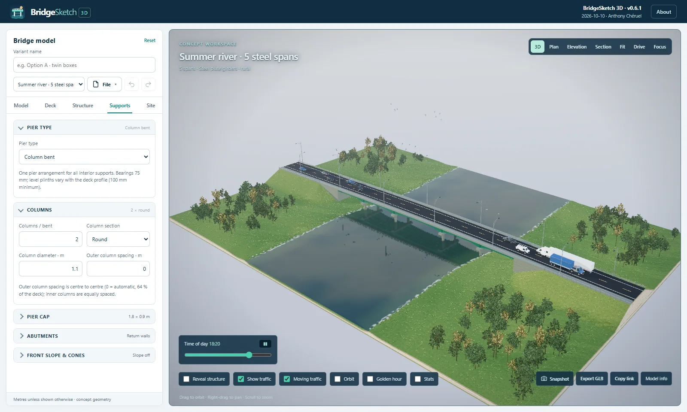
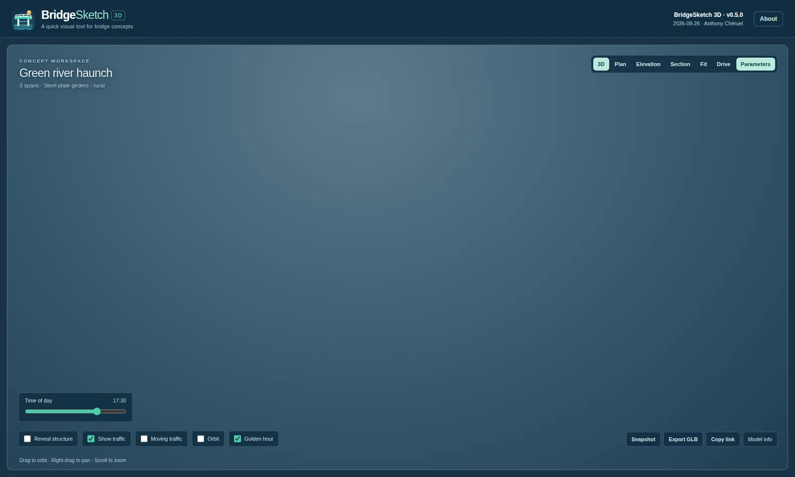

# BridgeSketch 3D

**Try it online:** [BridgeSketch 3D on GitHub Pages](https://acfakkoh.github.io/BridgeSketch-3D/)

**A quick visual tool for bridge concepts** · Version 0.6.1 · 10 October 2026 · Anthony Chéruel

BridgeSketch 3D is a browser-based, interactive 3D bridge configurator. Choose a span arrangement, deck, supports and site, then inspect the result from above, below or along the obstacle being crossed. It runs entirely from local files, with no account, backend, build step or runtime internet dependency.

## Features

- **Bridge systems:** steel plate girders, NEBT precast, steel and concrete boxes, solid slabs, frames.
- **Alignment:** curves, skew, crossfall and vertical profiles.
- **Supports:** wall, hammerhead, bent, portal and V piers, plus abutments.
- **Site:** rivers, roads, railways, open ground, terrain, weather and time of day.
- **Presentation:** bloom, sky, traffic and birds.
- **Parameters:** collapsible sections and formulas in numeric fields, such as `=12*3`.
- **History:** undo and redo with Ctrl+Z / Ctrl+Y.
- **Files and export:** save and open JSON, share link, PNG snapshot and GLB export.

## What's new in 0.6.1

- **Interface:** QuickerBridge-style collapsible groups, formulas in numeric fields, a File menu with undo/redo, a modified marker and local autosave.
- **Vehicles and birds:** clear-coat paint, contact shadows and a realistic colour mix; gull-like birds with an on/off option.
- **Piers:** rounded, pointed or square wall ends; hammerheads with shaped shafts and heads; inclined-leg portal frames; V piers with or without a crosshead.
- **Rendering:** light bloom, switchable with **Glow** in Balanced and High quality.
- **Editing:** parameter changes no longer show the loading logo or recompile shaders, and grass is cached between edits.
- **Concrete:** cool grey (default) and warm pale grey; NEBT girders are fixed-depth only.

## Run it

- **Online:** open the [GitHub Pages demo](https://acfakkoh.github.io/BridgeSketch-3D/) in a modern desktop browser with WebGL 2.
- **Offline on Windows:** extract the offline archive, double-click `OPEN_OFFLINE.cmd`, keep its PowerShell window open and visit [http://127.0.0.1:5174/](http://127.0.0.1:5174/). Node.js and an internet connection are not needed. Use the localhost address rather than opening `index.html` directly, because browsers block the module loading the app needs from `file://` URLs.
- **Self-hosting:** see [GITHUB_PAGES.md](docs/GITHUB_PAGES.md).
- **Sharing:** a link copied from a localhost session opens only where the offline server runs; a Pages link opens anywhere.

## Controls

- Drag to orbit, right-drag to pan and scroll to zoom; **Fit** reframes the bridge.
- Switch between **3D**, **Plan**, **Elevation** and **Section** views. Section views can be saved as SVG.
- The **Time of day** slider covers 00:00–24:00; **Golden hour** jumps to 19:00.
- Curated concepts sit at the top of the parameter panel. Choosing one resets every parameter.
- **Drive** travels along the road, railway or river beneath a middle span; **Escape** returns.

## Scope

BridgeSketch 3D produces concept and presentation geometry, not structural design.

## Credits and licences

- **Kenney** (CC0 1.0): [Car Kit 3.1](https://kenney.nl/assets/car-kit), [Train Kit](https://kenney.nl/assets/train-kit), [City Kit Suburban](https://kenney.nl/assets/city-kit-suburban) and [City Kit Commercial](https://kenney.nl/assets/city-kit-commercial).
- **Poly Haven** (CC0 1.0): rough concrete, asphalt, concrete wall and leafy grass textures.
- **Other CC0 textures:** river water from [Hazmat Harry](https://opengameart.org/content/seamless-water-tiles) and [qubodup](https://opengameart.org/content/3-live-proceduraly-generated-tiling-water-textures-512px-running-brushes) on OpenGameArt; bark from ambientCG.
- **MIT:** [Three.js](https://github.com/mrdoob/three.js); [EZ-Tree](https://github.com/dgreenheck/ez-tree) by Daniel Greenheck (tree generator, with `webgl-noise` by Ashima Arts); [CK42BB procedural stars](https://github.com/CK42BB/procedural-stars-threejs) and [procedural grass](https://github.com/CK42BB/procedural-grass-threejs); [Tw1ddle Sky-Shader](https://github.com/Tw1ddle/Sky-Shader) (physical sky); Steve245270533 three-stylized (grass shading ideas).
- Full credits and retained licences: [vehicle credits](models/VEHICLE_CREDITS.md), [train and building credits](models/SCENE_CREDITS.md), [texture credits](textures/CREDITS.md) and [generated texture notes](textures/GENERATED.md). Vendor notices are under `vendor/`.
